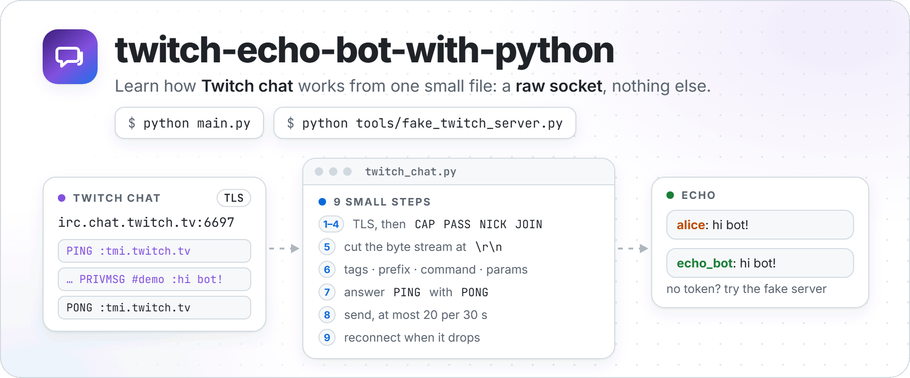
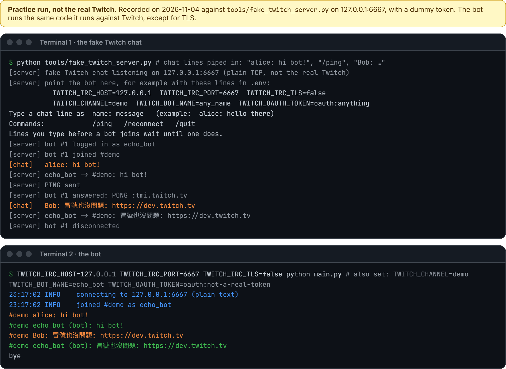
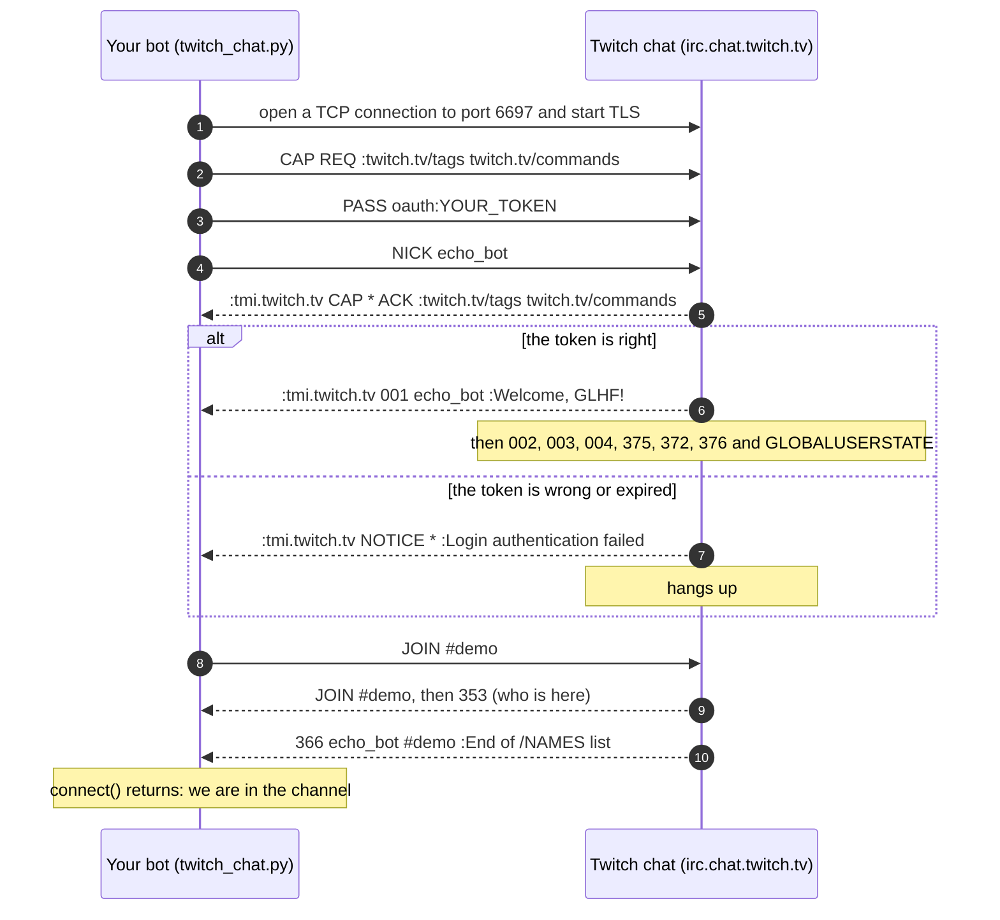
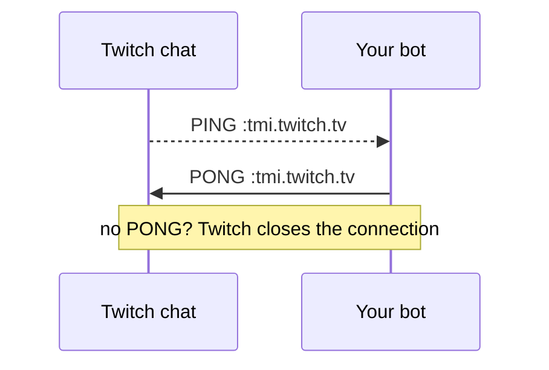
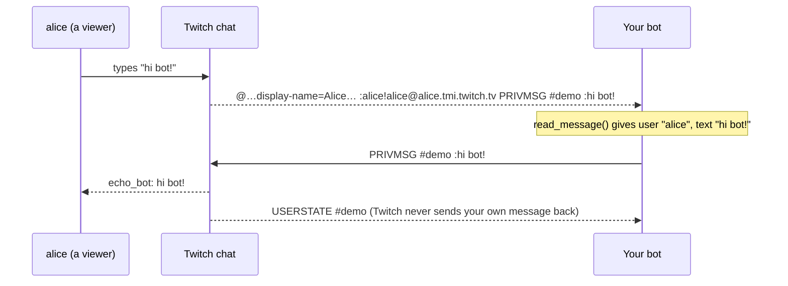
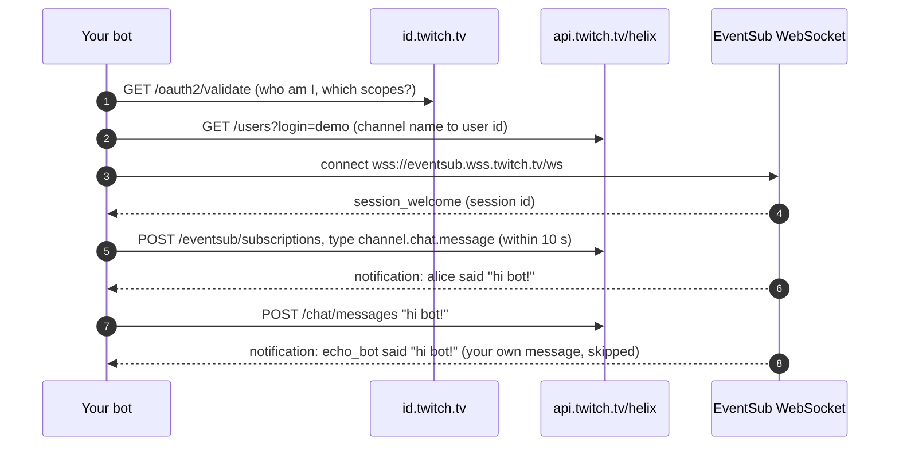

<p align="center">
  <picture>
    <source media="(prefers-color-scheme: dark)" srcset="https://raw.githubusercontent.com/NatLee/twitch-echo-bot-with-python/master/docs/images/hero-dark.png">
    
  </picture>
</p>

<p align="center">
  <a href="https://github.com/NatLee/twitch-echo-bot-with-python/actions/workflows/ci.yml"></a>
  
  
  <a href="./LICENSE"></a>
</p>

A Twitch chat bot that repeats every message back into the channel, written with a plain
socket and nothing outside Python's standard library, so you can see every line that goes
over the wire. Read [`twitch_chat.py`](twitch_chat.py) from top to bottom and you will know
how Twitch chat works: connecting, logging in, joining a channel, reading messages,
answering PING, staying under the rate limit and reconnecting. No Twitch account yet? A
small fake Twitch server in this repo lets you try everything on your own computer.

- [Quick start](#quick-start): try it with the fake server, then with real Twitch
- [How Twitch chat works, step by step](#how-twitch-chat-works-step-by-step)
- [The same bot with a ready-made package](#the-same-bot-with-a-ready-made-package) (issue #1)
- [Next step: EventSub, the way Twitch recommends now](#next-step-eventsub-the-way-twitch-recommends-now)
- [Tests](#tests) · [Files](#files) · [Code from 2019](#code-from-2019)

## Quick start

You need Python 3.10 or newer. The bot itself installs nothing.

```bash
git clone https://github.com/NatLee/twitch-echo-bot-with-python.git
cd twitch-echo-bot-with-python
```

### 1. Try it without a Twitch account

Open two terminals in the repo folder. In the first one, start the fake Twitch chat:

```bash
python tools/fake_twitch_server.py
```

In the second one, start the bot and point it at the fake server. The fake server takes any
token that starts with `oauth:`.

```bash
# macOS / Linux / Git Bash
TWITCH_IRC_HOST=127.0.0.1 TWITCH_IRC_PORT=6667 TWITCH_IRC_TLS=false \
TWITCH_CHANNEL=demo TWITCH_BOT_NAME=echo_bot TWITCH_OAUTH_TOKEN=oauth:anything \
python main.py
```

```powershell
# Windows PowerShell
$env:TWITCH_IRC_HOST="127.0.0.1"; $env:TWITCH_IRC_PORT="6667"; $env:TWITCH_IRC_TLS="false"
$env:TWITCH_CHANNEL="demo"; $env:TWITCH_BOT_NAME="echo_bot"; $env:TWITCH_OAUTH_TOKEN="oauth:anything"
python main.py
```

Now type `alice: hi bot!` in the first terminal. You are alice, a viewer; the bot answers.
Type `/ping` to see the bot answer a PING, and `/reconnect` to watch it reconnect.

<p align="center">
  
</p>

Add `--debug` to see every raw IRC line the bot sends (`>`) and receives (`<`). The token
is never printed. From a second practice run (the final `bye` left out):

```text
23:17:07 INFO    connecting to 127.0.0.1:6667 (plain text)
23:17:07 DEBUG   > CAP REQ :twitch.tv/tags twitch.tv/commands
23:17:07 DEBUG   > PASS ***
23:17:07 DEBUG   > NICK echo_bot
23:17:07 DEBUG   < :tmi.twitch.tv CAP * ACK :twitch.tv/tags twitch.tv/commands
23:17:07 DEBUG   < :tmi.twitch.tv 001 echo_bot :Welcome, GLHF!
23:17:07 DEBUG   > JOIN #demo
(… 7 lines left out: 002 to 376 and GLOBALUSERSTATE …)
23:17:08 DEBUG   < :echo_bot!echo_bot@echo_bot.tmi.twitch.tv JOIN #demo
23:17:08 DEBUG   < :echo_bot.tmi.twitch.tv 353 echo_bot = #demo :echo_bot
23:17:08 DEBUG   < :echo_bot.tmi.twitch.tv 366 echo_bot #demo :End of /NAMES list
23:17:08 INFO    joined #demo as echo_bot
23:17:08 DEBUG   < @badge-info=;badges=;color=;display-name=echo_bot;emote-sets=0;mod=0;subscriber=0;user-type= :tmi.twitch.tv USERSTATE #demo
23:17:08 DEBUG   < @room-id=1000;slow=0 :tmi.twitch.tv ROOMSTATE #demo
23:17:08 DEBUG   < @badge-info=;badges=;color=#1E90FF;display-name=Alice;emotes=;first-msg=0;flags=;id=00000000-0000-0000-0000-000000000001;mod=0;room-id=1000;subscriber=0;tmi-sent-ts=1793747827973;turbo=0;user-id=2510;user-type= :alice!alice@alice.tmi.twitch.tv PRIVMSG #demo :hi bot!
#demo Alice: hi bot!
23:17:08 DEBUG   > PRIVMSG #demo :hi bot!
#demo echo_bot (bot): hi bot!
23:17:08 DEBUG   < @badge-info=;badges=;color=;display-name=echo_bot;emote-sets=0;mod=0;subscriber=0;user-type= :tmi.twitch.tv USERSTATE #demo
23:17:08 DEBUG   < PING :tmi.twitch.tv
23:17:08 DEBUG   > PONG :tmi.twitch.tv
```

### 2. Get a token

Twitch chat needs a **user access token** for the bot's account. For this bot it needs two
scopes (permissions): `chat:read` to read chat and `chat:edit` to send messages. If you also
want to try the [EventSub example](#next-step-eventsub-the-way-twitch-recommends-now), add
`user:read:chat` and `user:write:chat`.

One way that uses only Twitch's own tools:

1. Log in to the [Twitch Developer Console](https://dev.twitch.tv/console/apps) with the bot
   account and register an application. Set the OAuth Redirect URL to
   `http://localhost:3000`. Note the Client ID and create a Client Secret.
2. Install the [Twitch CLI](https://dev.twitch.tv/docs/cli/) and give it the two values:
   `twitch configure`.
3. Ask for a token. A browser window opens; log in as the bot and allow access.

   ```bash
   twitch token -u -s 'chat:read chat:edit user:read:chat user:write:chat'
   ```

The command prints a User Access Token. That is what goes in `TWITCH_OAUTH_TOKEN`; the
`oauth:` in front is optional. User tokens expire, so run the command again when the bot
reports `Login authentication failed`.

Treat the token like a password. Anyone who has it can chat as your bot.

### 3. Run it on Twitch

Copy the settings template and fill it in:

```bash
cp .env.example .env
```

```ini
TWITCH_CHANNEL=your_channel        # the channel to join, without #
TWITCH_BOT_NAME=your_bot_account   # the account the token belongs to
TWITCH_OAUTH_TOKEN=...             # from step 2
```

`.env` is in `.gitignore`, so git will not pick it up. Settings already set in your shell
win over the file. Then:

```bash
python main.py
```

The bot connects to `irc.chat.twitch.tv:6697` with TLS, joins your channel and repeats
whatever people say. Stop it with Ctrl+C. To build your own bot, change the line marked
`<- change this line` in [`main.py`](main.py).

> [!NOTE]
> Everything in this repo was tested against the fake server and in CI, not against the real
> Twitch: we had no Twitch account token to test with. The fake server answers with the
> lines Twitch's documentation shows, but it is not Twitch. If something behaves differently
> on Twitch, please open an issue.

## How Twitch chat works, step by step

Twitch chat is an [IRC](https://en.wikipedia.org/wiki/IRC) server. IRC is a text protocol
from 1988: every command is one line of text that ends with `\r\n`. A bot opens a
connection, sends a few such lines to log in and join a channel, and from then on reads
lines from Twitch and answers some of them. The steps below match the `STEP` comments in
[`twitch_chat.py`](twitch_chat.py). Twitch's own description is in
[IRC Concepts](https://dev.twitch.tv/docs/chat/irc/) (read on 2026-11-04).

### Steps 1 to 4: connect, ask for extras, log in, join



1. **Connect.** `socket.create_connection` opens the connection and `ssl` wraps it in TLS,
   so nobody on the way can read your token. Port 6697 is TLS; 6667 is the same chat
   without encryption (the 2019 version used that). Twitch also offers
   `wss://irc-ws.chat.twitch.tv:443` for WebSocket clients such as web pages.
2. **Ask for extras.** `CAP REQ` asks for Twitch's additions to IRC. `twitch.tv/tags`
   adds details to each message, such as the viewer's display name and user ID. Twitch only
   gives tags to bots that also ask for `twitch.tv/commands`.
3. **Log in.** `PASS` carries the token with `oauth:` in front, then `NICK` gives the
   bot's login name in lowercase. The order matters: Twitch rejects `NICK` before `PASS`.
   Success is a burst of numbered lines that starts with `001`.
4. **Join.** `JOIN #channel`. Twitch confirms with `366 … :End of /NAMES list`. For a
   channel that does not exist, Twitch says nothing at all, so the bot gives up after 15
   seconds of silence (`HANDSHAKE_TIMEOUT`) and tells you to check the name.

### Step 5: TCP is a stream, not a list of messages

`recv(4096)` returns whatever bytes have arrived: maybe half a line, maybe five lines.
Twitch's docs even warn that what the server sends "may contain a single message or
multiple messages". So the bot keeps a buffer (`LineBuffer`), cuts it at `\r\n` and only
hands out complete lines.
It cuts the bytes first and decodes each finished line afterwards, because a character
like 你 is three bytes in UTF-8 and can be split between two packets.

### Step 6: the four parts of a line

<p align="center">
  <picture>
    <source media="(prefers-color-scheme: dark)" srcset="https://raw.githubusercontent.com/NatLee/twitch-echo-bot-with-python/master/docs/images/message-anatomy-dark.png">
    
  </picture>
</p>

`parse_line()` splits a line into **tags** (only there because we asked in step 2),
**prefix** (who sent it), **command** and **params**. The rule that matters: the first
`" :"` starts the last parameter, and everything after it belongs to that parameter. That
is why you must never cut a line with `split(":")`: chat text is full of colons, and every
link has one.

Tag values cannot contain spaces or `;`, so Twitch writes them as escapes from the
[IRCv3 message tags](https://ircv3.net/specs/extensions/message-tags) spec: `\s` is a
space, `\:` is `;`, `\\` is a backslash. `unescape_tag_value()` turns them back.

### Step 7: PING and PONG



From time to time (Twitch does not say how often) Twitch checks that the bot is still
there. The bot answers `PONG` with the same text the `PING` carried. `read_message()` does
this for you and never returns a PING as a chat message. Only a line whose *command* is `PING` counts; a viewer who types
"PING :tmi.twitch.tv" in chat is just chatting.

### Step 8: sending, and the rate limit



`send_message()` sends `PRIVMSG #channel :text`. A line break in the text would end the
command and start a new one, so the bot turns line breaks into spaces first.

Twitch limits how fast a bot may talk. For a bot that is not the broadcaster, a moderator
or a VIP, the [rate limits](https://dev.twitch.tv/docs/chat/#rate-limits) are 20 messages
in any 30 seconds and 1 message per second in a channel. Go over and Twitch ignores the
bot's messages for an hour. `RateLimiter` remembers recent sends and waits before the next
one would break a rule. The numbers are in `DEFAULT_RATE_LIMITS`; if your bot is a moderator
in the channel, Twitch allows 100 per 30 seconds and you can pass your own `rate_limits`.
Twitch also drops a message that is identical to the one you sent less than 30 seconds
ago; the bot logs Twitch's `NOTICE` when that happens.

### Step 9: when the connection ends

Connections end. Twitch restarts servers and sends `RECONNECT` first, networks drop, and
when Twitch closes the connection `recv()` returns empty bytes. In all these cases
`TwitchChat` raises `ConnectionClosed`. [`main.py`](main.py) catches it, waits 1, 2, 4, 8,
16, then 30 seconds between tries (`RECONNECT_DELAYS`), connects again and joins the channel
again. A wrong token or channel name is different: retrying will not help, so `main.py`
stops and tells you what Twitch said.

## The same bot with a ready-made package

[Issue #1](https://github.com/NatLee/twitch-echo-bot-with-python/issues/1) asked why not use
an existing IRC package. For a real bot, you should.
[`examples/irc_library_echo.py`](examples/irc_library_echo.py) is the same echo bot on the
[`irc`](https://pypi.org/project/irc/) package, about 50 lines of logic:

```bash
pip install -r examples/requirements.txt
python -m examples.irc_library_echo
```

It reads the same `.env`. Compare it with `twitch_chat.py`: the package opens the socket,
splits lines, parses them, answers PING and reconnects (steps 1, 5, 6, 7 and 9). You still
write the Twitch parts yourself: the `oauth:` password, `CAP REQ`, `JOIN`, the
`display-name` tag and the rate limit.

This repo keeps a raw socket on purpose. It is a lesson, and the package hides exactly the
parts you came to see. The bugs fixed in the 2019 code (next section) were all in those
hidden parts. Once you have seen them, using a package is the right call. For a bigger bot,
also look at [TwitchIO](https://pypi.org/project/twitchio/), which speaks EventSub and the
Twitch API for you.

## Next step: EventSub, the way Twitch recommends now

IRC still works, but Twitch's [chat documentation](https://dev.twitch.tv/docs/chat/) now
recommends EventSub for reading chat and the Send Chat Message API for sending. Its
[IRC page](https://dev.twitch.tv/docs/chat/irc/) says IRC "has some limitations versus
EventSub, and is more complicated to parse". EventSub means Twitch
pushes events to you as JSON over a WebSocket. Twitch has not announced an end date for IRC
(checked 2026-11-04).

[`examples/eventsub_echo.py`](examples/eventsub_echo.py) is the echo bot built that way,
following Twitch's [example chatbot](https://dev.twitch.tv/docs/chat/chatbot-guide/):



```bash
pip install -r examples/requirements.txt
python -m examples.eventsub_echo
```

What changes compared with IRC:

| | IRC (`main.py`) | EventSub (`examples/eventsub_echo.py`) |
|---|---|---|
| Scopes | `chat:read`, `chat:edit` | `user:read:chat`, `user:write:chat` |
| Reading | `PRIVMSG` lines on one socket | JSON `notification` messages on a WebSocket |
| Sending | `PRIVMSG` on the same socket | `POST /helix/chat/messages` |
| Still alive? | answer `PING` with `PONG` | expect a message every `keepalive_timeout_seconds` |
| Your own messages | never sent back to you | sent back: skip them or the bot echoes itself forever |
| Moving servers | `RECONNECT`: connect again | `session_reconnect`: connect to the new URL, the subscription moves along |

The example closes the old WebSocket before it opens the new one after `session_reconnect`.
Twitch suggests keeping both open until the new one says welcome, so a message sent in
that moment can be lost.

## Tests

The tests start a fake Twitch server on a free local port and never touch the real Twitch.
They cover each step above, the 2019 bugs below, the old `twitchSocket` calls, `main.py`
as a real process, and both examples (the EventSub one against fakes of the Twitch API and
EventSub WebSocket).

```bash
pip install -r requirements-dev.txt
pytest
ruff check .
```

No Python on your machine? Docker works too:

```bash
docker run --rm -v "$PWD:/src:ro" python:3.12-slim sh -c \
  'cp -r /src /w && cd /w && pip install -q -r requirements-dev.txt && pytest'
```

GitHub Actions runs the same on Python 3.10 to 3.14 for every push and pull request.

## Files

| File | What it is |
|---|---|
| [`twitch_chat.py`](twitch_chat.py) | the lesson: the IRC client in 9 steps, standard library only |
| [`main.py`](main.py) | the echo bot: settings, the echo loop, reconnecting |
| [`config.py`](config.py) | reads settings from the environment and `.env` |
| [`.env.example`](.env.example) | template for your `.env` |
| [`tools/fake_twitch_server.py`](tools/fake_twitch_server.py) | the fake Twitch chat, for practice and tests |
| [`examples/`](examples/) | the same bot on the `irc` package, and on EventSub |
| [`twitchSocket.py`](twitchSocket.py) | the 2019 names, kept so old scripts keep working |
| [`tests/`](tests/) | pytest tests |
| [`docs/images/src/`](docs/images/src/) | HTML sources of the pictures in this README |

## Code from 2019

Scripts written for the 2019 version still work, unchanged:

```python
from twitchSocket import twitchSocket

ts = twitchSocket(channelName="your_channel", botName="your_bot", botAuth="oauth:...")
while True:
    username, message = ts.getMsg()
    ts.sendMsg(message)
```

`twitchSocket` now runs on `twitch_chat.TwitchChat` and prints a `DeprecationWarning`
pointing there. It stays until at least 2027-11-04; [`twitchSocket.py`](twitchSocket.py)
says what to check before removing it. The new names:

| 2019 | now |
|---|---|
| `twitchSocket(channelName=, botName=, botAuth=)` | `TwitchChat(channel=, nick=, token=)`, then `connect()` |
| `getMsg()` returns `(username, message)` | `read_message()` returns a `ChatMessage` (`.user`, `.text`, `.display_name`, `.tags`) |
| `sendMsg(message)` | `send_message(text)` |

### What the 2019 version got wrong

All of these were reproduced against the fake server before the rewrite, and each has a
test now.

- **It crashed within minutes.** A PING made `getMsg()` return `(None, None)`, and
  `sendMsg(None)` then raised `TypeError`, which the loop did not catch.
- **Colons cut messages short.** `split(":")` turned `look at this: https://example.com`
  into `look at this`.
- **Two lines in one packet lost the second.** One `recv()` was treated as one line. When a
  PING and a chat line arrived together, the bot reported a viewer called `tmi.twitch.tv`
  and echoed IRC protocol text.
- **A character split between packets crashed it.** Decoding each `recv()` on its own
  failed on half a 你, and the error handler then failed too.
- **It never noticed a closed connection.** `recv()` returned empty bytes forever and the
  loop spun at full CPU. A wrong token or a misspelled channel hung the constructor.
- **It sent the token in plain text** to the old host `irc.twitch.tv:6667`, and the token
  lived in `main.py`, one `git commit` away from being public.
- **It answered PONG to chat text** that contained `PING :tmi.twitch.tv`, always with a
  hard-coded reply.
- **No rate limit**, so a busy chat could get the bot ignored for an hour.

## License

[MIT](./LICENSE)
